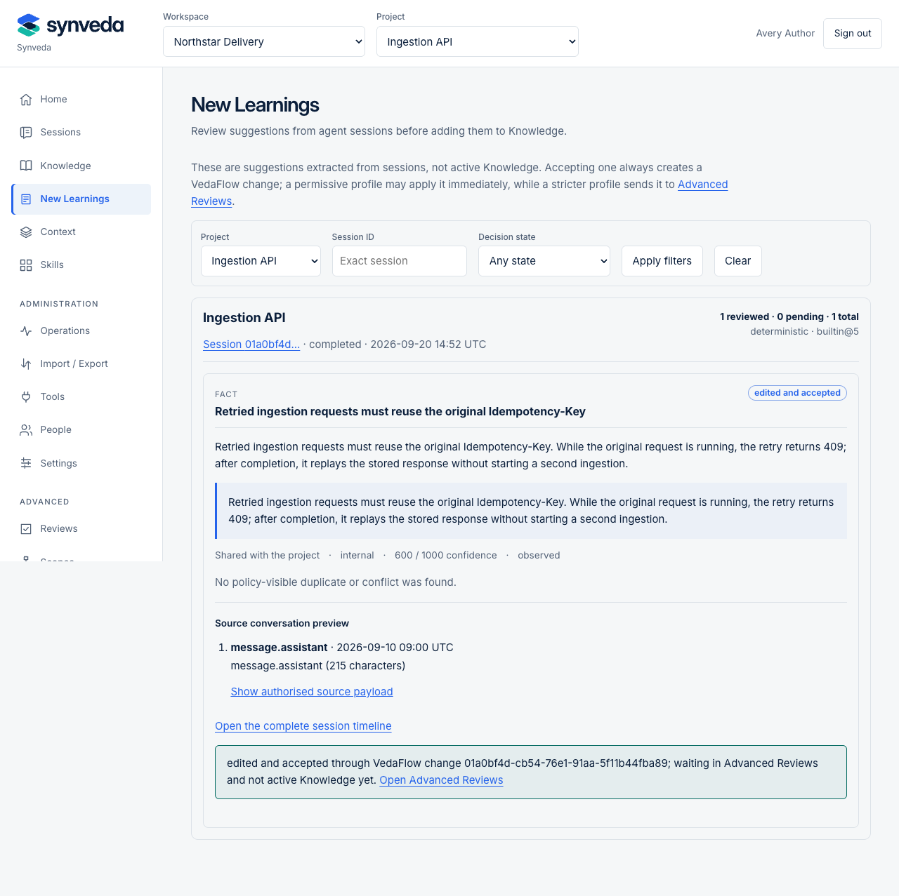

<picture>
  <source media="(prefers-color-scheme: dark)" srcset="assets/brand/synveda-lockup-dark.svg">
  
</picture>

# Synveda

**Reviewed, shared project knowledge for AI coding agents.** Synveda is a
self-hosted service that records what agents do in a project, proposes
learnings from those sessions for people to review, and gives later sessions
the approved knowledge as context.

An agent often works out something useful — a retry rule, a build quirk, a
team convention — and the finding stays in that one conversation. The next
session, or a teammate's agent, starts without it. Notes copied into prompt
files by hand lose their source, and nothing decides who may read them.
Synveda keeps each finding with the session it came from, lets a reviewer
decide whether it becomes project knowledge, and checks access on every read.



*The console with fictional sample data: a proposed learning, its source
session and its review state.*

## What you can do with it

| You want to | What Synveda does | What it needs |
| --- | --- | --- |
| Keep findings from agent sessions | Client hooks record session events. After a session closes, a background worker proposes learnings from it. The default extractor is rule-based and calls no model API. | A supported client with Synveda's hooks, and recording turned on for the repository. |
| Decide what becomes shared knowledge | **New Learnings** lets you accept, edit, merge, replace or dismiss a proposal. Policy decides whether a change applies at once or waits for reviewers. Approved knowledge is stored as immutable revisions linked to their sources. | A reviewer with access to the project. |
| Start the next session informed | At session start, the client hook requests context: relevant approved knowledge within a configurable token budget (1,500 estimated tokens in the built-in templates). Agents can search further through the MCP `recall` tool. The **Context Inspector** shows which revisions were selected and why. | Approved knowledge in a project the session can read. |
| Control who sees what | Knowledge belongs to a personal scope, a workspace or a project. Roles are granted per scope. Embedded Cedar policy checks every read and write, PostgreSQL row-level security enforces tenant isolation, and a hash-chained audit log records decisions without copying knowledge bodies. | An OIDC identity provider (Keycloak is bundled for evaluation). |
| Share reviewed agent instructions | Versioned Skill bundles are reviewed, then synced to Claude Code or Codex CLI skills folders. MCP server definitions can be recorded for a project; the gateway never runs those tools. | The native `synveda` client. |

The default Docker evaluation makes no calls to model, embedding or analytics
services: search is PostgreSQL full-text search, and telemetry goes to a local
collector that discards it. The Kubernetes chart can optionally add semantic
search (a Text Embeddings Inference service) or a model-based extractor
(Anthropic or an OpenAI-compatible endpoint), each also gated by governed
configuration. Knowledge is stored in plain text in PostgreSQL; encrypt the
database volume if you need encryption at rest.

### How it fits together (illustrative)

1. A developer's Claude Code session on the *Ingestion API* project finds that
   retried requests must reuse the original `Idempotency-Key`.
2. When the session closes, Synveda proposes that as a learning, linked to the
   session event it came from.
3. A project reviewer edits the wording and approves it.
4. The next session in that project starts with the approved revision in its
   context. Any agent can also find it with `recall`.

The quickstart below runs this flow with fictional sample data and no agent.

## Try it locally

<a id="install-for-local-evaluation"></a>
This route uses the prebuilt Docker bundle from the latest release, **v0.4.7**,
with bundled PostgreSQL and Keycloak. It needs no source checkout, compiler,
cloud account or model API key.

<!-- installation-version: 0.4.7; publication: published -->
**Prerequisites**

- A native Linux host, AMD64 or ARM64. macOS, Docker Desktop and Windows/WSL2
  are not yet qualified; see the [platform limits](docs/PRODUCTION_READINESS.md).
- Docker Engine 28+ with Compose 2.33.1+, used from an ordinary (non-root)
  account through the local Docker socket. Allow at least 6 GiB for Docker.
- `curl`, `tar`, `sha256sum` or `shasum`, and the [GitHub CLI](https://cli.github.com/)
  (`gh`) to verify the release publisher.
- A browser on the same machine: the console listens on `127.0.0.1` only, over
  plain HTTP.

### 1. Download and verify

Run this whole block in a terminal, from a directory where the new
`synveda-0.4.7` folder can be created. It extracts the bundle only after the
publisher attestation and checksum both pass. `SOURCE_SHA` is the release's
source commit from the [v0.4.7 release notes](https://github.com/synveda/synveda/releases/tag/v0.4.7).

```sh
(
  set -eu
  RELEASE_VERSION=0.4.7
  SOURCE_SHA=42308fd6ccefed16b7fdab7147bb698d0bf4e0c4
  release_url="https://github.com/synveda/synveda/releases/download/v$RELEASE_VERSION"
  mkdir "synveda-$RELEASE_VERSION" || exit 1
  cd "synveda-$RELEASE_VERSION" || exit 1
  for file in "synveda-reference-$RELEASE_VERSION.tar.gz" SHA256SUMS SHA256SUMS.sigstore.json; do
    curl --fail --location --proto '=https' --proto-redir '=https' \
      --connect-timeout 15 --max-time 120 --output "$file" "$release_url/$file" || exit 1
  done
  gh attestation verify SHA256SUMS --bundle SHA256SUMS.sigstore.json \
    --repo synveda/synveda \
    --signer-workflow synveda/synveda/.github/workflows/release.yml \
    --source-ref "refs/tags/v$RELEASE_VERSION" --source-digest "$SOURCE_SHA" \
    --cert-oidc-issuer https://token.actions.githubusercontent.com \
    --predicate-type https://slsa.dev/provenance/v1 --deny-self-hosted-runners || exit 1
  awk -v file="synveda-reference-$RELEASE_VERSION.tar.gz" \
    '$2 == file { count++; print } END { if (count != 1) exit 1 }' \
    SHA256SUMS > reference.sha256 || exit 1
  if command -v shasum >/dev/null 2>&1; then
    shasum -a 256 --check reference.sha256 || exit 1
  else
    sha256sum --check reference.sha256 || exit 1
  fi
  tar -xzf "synveda-reference-$RELEASE_VERSION.tar.gz" || exit 1
) && cd synveda-0.4.7/synveda-reference-0.4.7
```

Success ends with `synveda-reference-0.4.7.tar.gz: OK` and leaves you in the
extracted bundle. Run the remaining commands from that directory.

### 2. Check the local settings

Open `evaluation.json` before the first start:

| Key | Default | Change it when |
| --- | --- | --- |
| `port` | `8080` | Another program already uses that port. |
| `subnet` | `10.231.60.0/24` | It overlaps your network, a VPN or another Docker network. |
| `demoAccounts` | `true` | Keep `true` for this walkthrough; `false` uses only identities you provision. |

The first start records these values with the installation's keys. Changing
them later is refused, so decide now.

### 3. Start Synveda

```sh
./synveda-compose up
```

The first start downloads the images and can take several minutes. It returns
when every service is healthy and prints the console URL,
`http://localhost:8080/console/` (or your port).

### 4. Load the sample

Run the sample **before** you use **Getting started** in the console:

```sh
./synveda-compose sample
```

It signs in the four generated demo accounts and uses the public API to create
the fictional **Northstar Delivery** workspace with an **Ingestion API**
project, a source session, a proposed retry learning and a proposed Skill
version. It approves nothing. You can run it again safely.

When it finishes it prints `Fictional Northstar sample: learning_pending`.

The order matters. The first workspace settings in an installation apply
directly; later ones follow the review rules. If you use **Getting started**
first, the sample stops at `compose-product: product-demo failed`
while its settings wait for two administrators other than the author. Choose
one route per installation: this sample, or your own empty workspace through
**Getting started**. The [Docker guide](deploy/compose/PREBUILT.md#pending-sample-configuration)
covers recovery if you have already done both.

### 5. Sign in and review the learning

```sh
./synveda-compose credential author
```

This prints the generated password for `synveda-demo-admin` (Avery Author). It
needs an interactive terminal. Open the console URL and sign in; the console
opens on **Northstar Delivery → Ingestion API**.

Open **New Learnings**. The retry finding is there with its source session and
a banner saying it is waiting in review. Note the change ID in that banner. The
sample requires its reviewer account's approval:

1. Run `./synveda-compose credential reviewer` and sign in as
   `synveda-demo-member` (Riley Reviewer) in a **private browser window**. The
   identity provider keeps the first account signed in otherwise.
2. Open `http://localhost:8080/console/advanced/reviews/CHANGE_ID`, using the
   change ID from the banner. The reviewer's workspace grants do not include
   the tenant-wide **Reviews** list, so it has no menu item and the list says it
   is not available, but the review page itself works.
3. Read the proposed content and its source, then select **Approve** and then
   **Apply approved change**. The state changes to `applied`: the learning is
   now active Knowledge.

### 6. Request context

Return to the window signed in as `synveda-demo-admin`; the reviewer account
cannot request context for the sample session. In **Context**, keep the sample
session selected, ask how ingestion retries should behave and select **Request
context**.

The result lists two selected revisions, the approved retry decision and the
sample's baseline convention, with reason codes such as *keyword match*. The
default budget is shown as 1,500 governed tokens. **Open selected Knowledge
revision** shows the approved text, its origin and its history. Two notices are
expected here: *Degraded retrieval: embedder*, because this bundle uses
full-text search only, and *Redacted trace*, because the sample's team settings
keep reason codes and revision links but not the rendered text. **Preview
context** shows a selection without recording a delivery.

That is the whole loop: a finding from a session, reviewed by a person and
delivered as context. To try it with a real agent, [connect a client](#connect-an-agent-client).

### Stop, resume and remove

```sh
./synveda-compose down   # stops containers; keeps databases and keys
./synveda-compose up     # resumes the same installation
```

The launcher always uses one Compose project, `synveda-evaluation`, with
private state under `~/.synveda/state`. Another directory does not create a
separate installation. Backup, restore and the explicitly confirmed reset are
in the [Docker guide](deploy/compose/PREBUILT.md#state-and-ordinary-lifecycle).

## Connect an agent client

Connect Claude Code, Codex CLI or GitHub Copilot CLI with four commands. Run
the last three from the root of the Git repository you work in:

```sh
curl -fsSL https://raw.githubusercontent.com/synveda/synveda/main/scripts/install.sh | sh
synveda login --gateway http://localhost:8080        # opens your browser to sign in
synveda setup --project PROJECT_ID --observation on   # run `synveda setup` first to list projects
synveda adapter install --client claude-code          # or codex, copilot-cli
```

On Windows, install with
`powershell -NoProfile -Command "irm https://raw.githubusercontent.com/synveda/synveda/main/scripts/install.ps1 | iex"`.
The installer verifies the release signature and checksums before it runs
anything. It uses the [GitHub CLI](https://cli.github.com) when a current one
is installed and otherwise downloads a hash-pinned copy for the run; no
administrator rights are needed. The
[agent setup guide](docs/AGENT_SETUP.md) explains each step, how to check that
it works and how to disconnect.

| Client | What `synveda adapter install` sets up | Guide |
| --- | --- | --- |
| Claude Code | The Synveda plugin: hooks and MCP server | [Claude Code adapter](adapters/claude-code/README.md) |
| Codex CLI | Hooks in `.codex/hooks.json` and the MCP server | [Codex CLI](docs/integrations/codex.md) |
| GitHub Copilot CLI | Hooks in `./.github/hooks/synveda.json` and the MCP server | [Copilot CLI](docs/integrations/copilot-cli.md) |

Hooks record a repository's sessions only after `--observation on`; context
works either way. Other MCP clients, such as Cursor or VS Code, can use
`recall` through `synveda adapter install --client NAME`. On native Windows the
client connects to a server running elsewhere. Python and TypeScript SDKs cover
an initial, unpublished part of the API; see the [SDK guide](sdks/README.md) and
the [OpenAPI contract](docs/api/openapi.json).

## Client support

Client guides: Claude Code 2.1.241, GitHub Copilot CLI 1.0.83, Codex CLI 0.152.0.

See the [client support matrix](docs/CLIENT_SUPPORT.md) for platform coverage,
setup steps and capabilities. This list comes from the
[adapter registry](adapters/registry.json).

## Key terms

| Term | Meaning |
| --- | --- |
| Workspace | A place for a person or team. People get access through grants on it. |
| Project | Where related sessions and knowledge live, inside a workspace. A workspace grant reaches its projects; a project grant stays in that project. |
| Personal scope | Each signed-in person's own scope, separate from workspaces. |
| Session | One agent run, recorded from client hook events. |
| Learning | A proposal extracted from a closed session. It is not knowledge until reviewed. |
| Knowledge | Approved, versioned facts, decisions, conventions, procedures and warnings, each revision linked to its source. |
| Context | What Synveda returns for a session: selected knowledge, within a budget, with the reasons for each selection. |
| Configuration | Versioned settings for a scope: policy pack, capture, context budget and trace detail. Changes are reviewed like knowledge. |

The [product guide](docs/INSTALL.md) explains access, configuration and review
in more depth.

## Deployment options

| Route | Use it for | Guide |
| --- | --- | --- |
| Docker bundle, local evaluation | One person on one Linux host, with bundled PostgreSQL and Keycloak | [Run with Docker](deploy/compose/PREBUILT.md) |
| Docker bundle, reference HTTPS | A small team on one host, with your DNS and TLS, and bundled or existing PostgreSQL and OIDC | [Use existing infrastructure](deploy/compose/PREBUILT.md#use-existing-infrastructure) |
| Helm chart | An existing Kubernetes cluster, with bundled or existing PostgreSQL and OIDC | [Deploy to Kubernetes](deploy/helm/synveda/README.md) |
| Source checkout | Changing Synveda or running its tests | [Development guide](docs/DEVELOPMENT.md) |

v0.4.7 is a controlled evaluation release with one gateway and one worker. It
is not yet production-ready: high availability, off-host disaster recovery,
production key management and supported upgrades between releases are open
work. Each release refuses databases from an incompatible schema, so back up
before trying a newer bundle. The [readiness assessment](docs/PRODUCTION_READINESS.md)
records current limits and evidence. v0.4.7 admits operator-managed
PostgreSQL 14–18, within the evidence tiers of the
[deployment contract](docs/DEPLOYMENT_CONTRACT.md#postgresql-compatibility),
and repairs browser invitation links.

## Learn more and contribute

- [Product guide](docs/INSTALL.md) — sign-in, access, configuration, reviews and client setup
- [Security model](docs/SECURITY.md) and [vulnerability reporting](SECURITY.md)
- [Architecture](docs/SYNVEDA_TECH_PLAN.md), [decision records](docs/adr/README.md) and [open work](docs/backlog/STATUS.md)
- [Contributing](CONTRIBUTING.md) and [source development](docs/DEVELOPMENT.md)
- [Issues](https://github.com/synveda/synveda/issues) for bugs and questions

<a id="run-with-prebuilt-docker-images"></a>
<a id="quick-start-from-a-source-checkout"></a>
Earlier installation links now lead to the [Docker guide](deploy/compose/PREBUILT.md)
and the [source development guide](docs/DEVELOPMENT.md).

Synveda is [Apache-2.0 licensed](LICENSE). See [NOTICE](NOTICE) and
[asset attributions](assets/brand/ATTRIBUTIONS.md).
